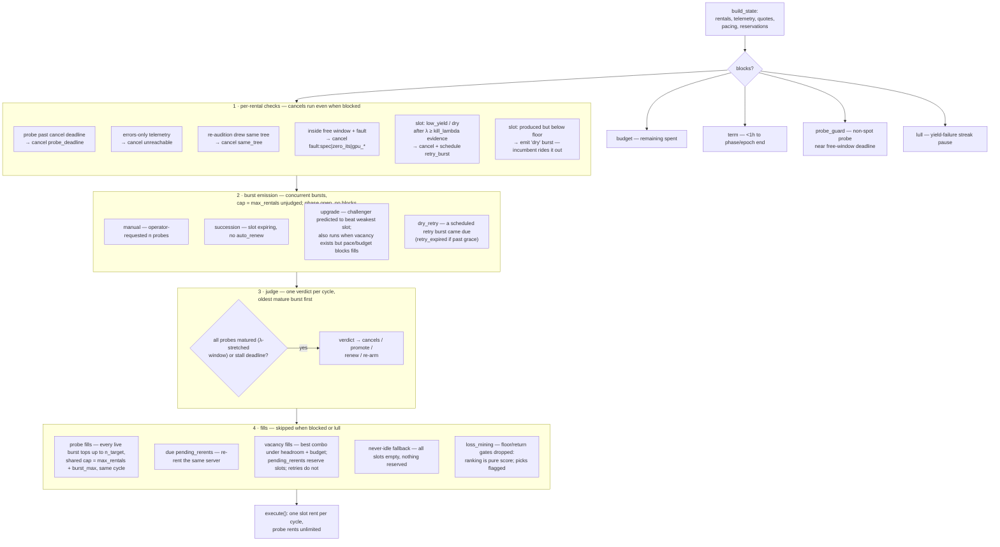
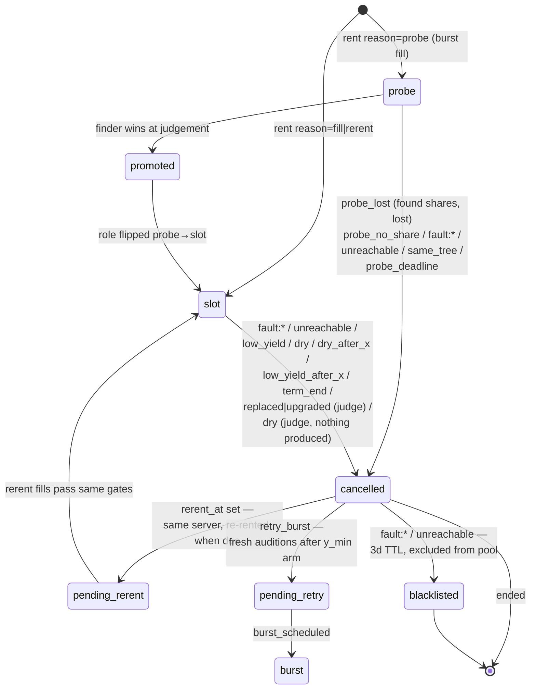
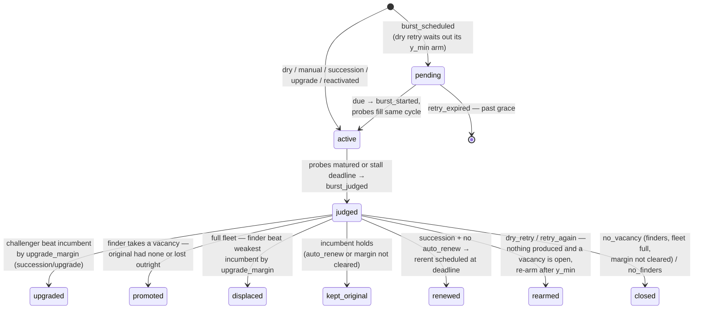

# Experiment runner — decision flow

Maps `experiment.py` (`decide` → `execute`, one pass per tick). Keep
this next to the code: when the logic changes, update the matching
section — a stale diagram is worse than none.

## Per-tick pipeline

`decide()` emits action dicts in this order; `execute()` applies
cancels first, then bursts, the judgement, then rents.

## Order lifecycle

## Burst lifecycle

## Verdicts & log vocabulary

| verdict | meaning |
|---|---|
| `upgraded` | challenger beat incumbent's forecast by `upgrade_margin`; incumbent cancelled `upgraded`, loser probes dropped |
| `promoted` | a finder took the slot — vacancy fill or weak-incumbent replace |
| `displaced` | fleet full: finder beat the weakest incumbent by `upgrade_margin`; incumbent cancelled `displaced` |
| `kept_original` | incumbent survives; all probes cancelled |
| `renewed` | succession: incumbent had no auto_renew → rerent scheduled at its deadline |
| `dry_retry` | burst + incumbent both produced nothing; incumbent cancelled `dry`, retry re-armed |
| `retry_again` | dry_retry burst, nothing produced, slot still open → re-arm |
| `no_vacancy` | finders existed but the fleet was full and none cleared `upgrade_margin` vs the weakest incumbent; probes dropped |
| `no_finders` | no probe produced a share and nothing else applied |

| trigger | why the burst exists |
|---|---|
| `dry` | slot produced but below yield floor — probes audition against the riding incumbent |
| `succession` | slot term ending, no auto_renew — audition a replacement before it expires |
| `upgrade` | a listing looks better than the weakest slot (fleet full, or fills blocked) |
| `dry_retry` | scheduled re-audition after a dry/low-yield cancel, after its y_min arm — reserves nothing |
| `reactivated` | resumed spot order gets an audition burst |
| `manual` | operator-requested burst |

| other terms | meaning |
|---|---|
| `finder` | probe that landed ≥1 share during its audition window |
| `econ_finder` | finder whose realized return also clears `min_return` |
| `tree_retry_order_ids` | healthy no-share probes tagged for a bounded re-audition (upgrade judgements only) |
| `gross_tiebreak` | under `score=gross`: gross $/h within this fraction is a near-tie — the contest is then arbitrated on net $/h instead, and the cheaper earner of the same revenue wins; judge stats report `tiebreak: "net"` when arbitration applied |
| `kill_lambda` / `kill_lambda_free` | dry/low-yield verdicts wait for λ expected shares (λ = predicted share-rate × hours), not a fixed clock — windows stretch with pool share difficulty; `_free` is the looser standard inside the free-cancel window. See [poisson-judging.md](poisson-judging.md) |
| `probe_guard` | block: an on-demand probe is near its free-cancel deadline; new rents wait |
| `pending_bursts` / `pending_rerents` | scheduled retries / re-rents; only `pending_rerents` reserve a vacancy in the fill math |
| `pending` (block) | a rent attempt parked `unknown`/`creating` — an ambiguous POST could mean a live order, so all actions freeze until it resolves |
| `attempt_recheck` | parked attempts older than `attempt_recheck_min` are re-polled against `my_orders` at that interval; `attempt_recheck_clear` consecutive clean fetches auto-resolve to `no_order`, a candidate keeps it parked for manual `rent.py reconcile` |

## Retries reserve nothing

A `dry_retry` is a pure audition: it fires when due whether or not a
vacancy exists, and the fill math ignores it. If a cold fill took the
slot meanwhile, a finder that still wants in must displace the weakest
incumbent by `upgrade_margin` (verdict `displaced`); otherwise the
judgement is `no_vacancy` and the chain ends — the upgrade scan owns
churn on a full fleet.
